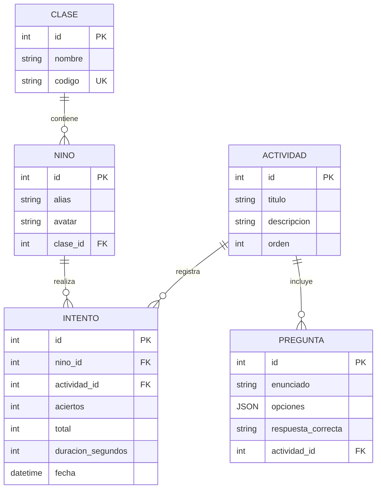

# Plan técnico

## Arquitectura

Capas: rutas, servicios, modelos y plantillas.

## Modelo de datos

## Contrato de API

| Método | Ruta | Descripción | Respuesta |
| --- | --- | --- | --- |
| GET | /salud | Estado del servicio | 200 |

## Decisiones

Cada decisión importante se registra como ADR en `specs/adr/`.
